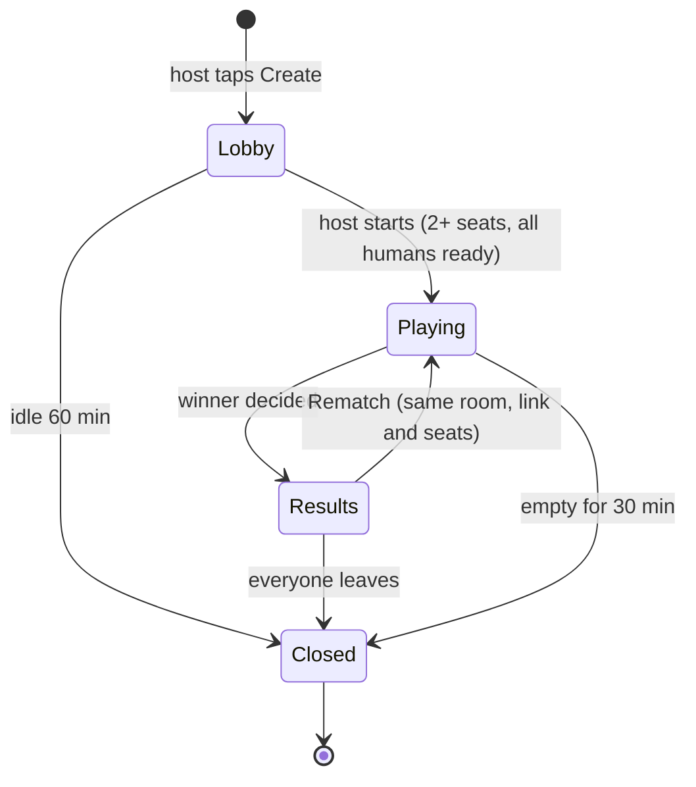
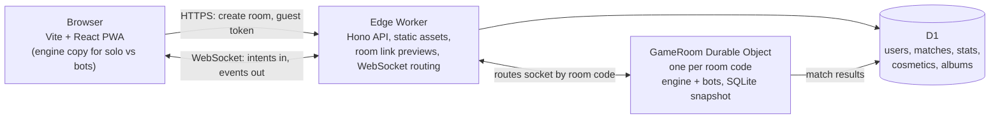
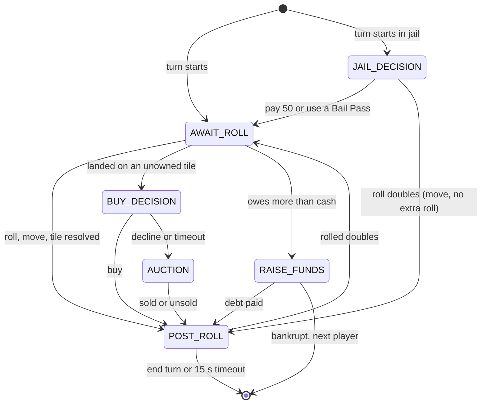
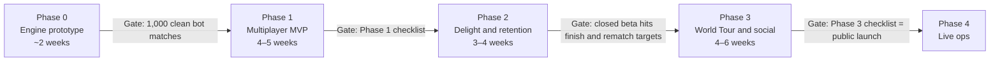

# Rollionaire — Product Requirements Document

Oct 14, 2026 · @Edwin Satya

## 1. TL;DR & key decisions

Rollionaire (working title) is a free, browser-based property-trading board game for 2–6 friends. Players join a room by link and play a full Monopoly-style match in real time, with no install and no sign-up.

It keeps the classic loop people love: roll, buy, collect rent, trade, build, and bankrupt your friends. On top, it adds Modoo Marble's pace and twists and [Monopoly GO](https://www.monopolygo.com/)'s social hooks, without their pay-to-win economy.

Target experience: tap a link on any phone or laptop, pick a token, and roll within 30 seconds. A Blitz match ends in about 25 minutes; a Classic match in 60–90 minutes.

| #   | Decision                                                                                  | Why it matters                                                                    |
| --- | ----------------------------------------------------------------------------------------- | --------------------------------------------------------------------------------- |
| 1   | English is the default language; Bahasa Indonesia is the second locale                    | Reaches a global audience; every string goes through i18n from day one            |
| 2   | Rooms are joined by a 6-character code or a share link with a rich preview                | Frictionless invites are the main growth loop                                     |
| 3   | The server is authoritative; clients only send intents                                    | Fair dice, no cheating, painless reconnection                                     |
| 4   | Original name, board, cards and art; no Hasbro, Scopely or Netmarble names or assets      | Mechanics can be reused; brand names, trade dress and artwork cannot              |
| 5   | Zero-cost build: open-source tools, free tiers, CC0 assets                                | Explicit requirement; free-tier quotas shape the architecture (section 12)        |
| 6   | Fun only: no real money, ads, loot boxes or pay-to-win; every reward is earned by playing | Keeps matches fair and avoids gambling-like mechanics                             |
| 7   | One rules engine, three modes: Classic, World Tour, Blitz                                 | Classic = Monopoly feel; World Tour = Modoo Marble twists; Blitz = short sessions |

## 2. Problem, goals & non-goals

Playing a Monopoly-style game with friends online today means picking between ad-heavy clones, pay-to-win mobile games, or a session nobody finishes. Rollionaire attacks the four reasons people quit.

- **Slow start:** installs, accounts and friend codes stand between "let's play" and the first roll.
- **Endless games:** classic matches often run past two hours, and stalemates are common.
- **Dead time:** the first player to go bankrupt, and everyone waiting for a slow turn, has nothing to do.
- **Money beats skill:** mobile hits lean on paid dice rolls, gacha characters or boosts.

### Goals

Targets are initial hypotheses for the first 90 days after public launch; revisit them after the closed beta.

| Goal               | Metric                                                    | Target                               |
| ------------------ | --------------------------------------------------------- | ------------------------------------ |
| Fast to start      | Median time from opening an invite link to the first roll | ≤ 60 s new players, ≤ 20 s returning |
| Games get finished | Started games that end with a winner                      | ≥ 65%                                |
| Friends play again | Rooms that start a rematch                                | ≥ 35%                                |
| Players come back  | Players who finish a game and return within 7 days        | ≥ 25%                                |
| Feels instant      | p95 action round-trip from Southeast Asia                 | ≤ 150 ms                             |
| Costs nothing      | Monthly infrastructure bill                               | $0 inside free-tier quotas           |

### Non-goals for v1

- Any monetization: real-money purchases, ads, betting, crypto or NFTs. The game exists purely for fun.
- Native iOS or Android apps; the web app installs as a PWA instead.
- A ranked ladder with skill-based matchmaking (later phase).
- Built-in voice chat; players use Discord or WhatsApp calls at launch.
- User-made boards (later; the board format is data-driven, so it stays possible).
- Licensing any Monopoly, Monopoly GO or Modoo Marble brand.

## 3. Target users & personas

The core user is a friend group of 3–6 people, roughly 16–35 years old, who already talk on WhatsApp or Discord and want a game night without installing anything. Design mobile-first: most sessions will run on mid-range Android phones over mobile data, so a 360 × 740 viewport and a flaky 4G link are the baseline.

| Persona              | Situation                                          | What they need                                                      | What wins them                                                           |
| -------------------- | -------------------------------------------------- | ------------------------------------------------------------------- | ------------------------------------------------------------------------ |
| The Host (primary)   | Organizes the group and drops the link in the chat | A room in two taps, control over rules, a way to remove AFK players | House rules, one-tap rematch, the group's match history                  |
| The Joiner (primary) | Taps the link on a phone, has no account           | Play as a guest in seconds and learn while playing                  | Guest play, tooltips that explain every charge, a smooth one-hand layout |
| The Family Table     | Parents, kids or cousins in different cities       | A simple mode, readable UI, patience for slow players               | Large-text option, relaxed timers, bots that fill empty seats            |
| The Solo Player      | Nobody is online right now                         | Practice or a quick match                                           | Bots at three difficulty levels; public quick match later                |
| The Organizer        | Runs a Discord server, school club or office event | Many rooms, spectators, a fair format                               | Spectator mode, custom room names, tournament brackets later             |

## 4. References: what we borrow, what we avoid

We copy proven mechanics, never brands or monetization. Classic Monopoly supplies the rules, Modoo Marble the pace and twists, and Monopoly GO the reward loops.

| Reference                                                                                                                                                            | Why it works                                                                                                                                                                                                                                  | We borrow                                                                                                                                                                                                                                                      | We avoid                                                                                |
| -------------------------------------------------------------------------------------------------------------------------------------------------------------------- | --------------------------------------------------------------------------------------------------------------------------------------------------------------------------------------------------------------------------------------------- | -------------------------------------------------------------------------------------------------------------------------------------------------------------------------------------------------------------------------------------------------------------- | --------------------------------------------------------------------------------------- |
| Classic Monopoly (Hasbro)                                                                                                                                            | Trading, monopolies, the housing squeeze, bankruptcy drama                                                                                                                                                                                    | The full ruleset as Classic mode: 40 tiles, 8 colour groups, 32 houses and 12 hotels, auctions, mortgages                                                                                                                                                      | The name, board art, tokens, card wording and mascot                                    |
| [Modoo Marble](https://www.kedglobal.com/newsView/ked202304040007) / [LINE Let's Get Rich](https://apps.apple.com/th/app/line-lets-get-rich/id870365423) (Netmarble) | About 200 million players; short matches for up to four on a world-city board, with landmarks, team play and [attack-style chance cards](https://www.apkmirror.com/apk/line-corporation/line-lets-get-rich/line-lets-get-rich-5-0-0-release/) | World Tour mode: travel tile, landmarks, a rent-boosting festival tile, takeovers, instant [Triple and Line Monopoly](https://www.invenglobal.com/lol/articles/18393/meta-world-landmarks-everywhere-twice-did-you-know-board-game-rule-guide) wins, 2v2 teams | Collectible characters and items that change the odds; any play-to-earn or crypto layer |
| [Monopoly GO](https://monopoly.fandom.com/wiki/Monopoly_Go) (Scopely)                                                                                                | Constant small rewards: railroad mini-games (Bank Heist, Shutdown), seasonal sticker albums traded between friends, partner events, tournaments, token collections                                                                            | Seasonal albums earned only by playing, duplicate trading between friends, co-op weekly goals, a light railroad mini-game in Party mode                                                                                                                        | Selling dice rolls, roll multipliers, energy timers, pay-to-progress                    |

Monopoly GO albums run about three months, with 21 sets of nine stickers each ([PCGamesN](https://www.pcgamesn.com/monopoly-go/wiki)); we copy that seasonal rhythm at a smaller scale (section 10). Modoo Marble's play-to-earn sequel was kept out of South Korea by its ban on cash-out games ([KED Global](https://www.kedglobal.com/newsView/ked202304040007)), one more reason to keep real money out entirely.

## 5. Product pillars

Every feature must serve at least one of four pillars; a feature that serves none waits for a later phase.

| Pillar                | Answers the problem | What it means in practice                                                       |
| --------------------- | ------------------- | ------------------------------------------------------------------------------- |
| Instant to join       | Slow start          | A link, a nickname, a token: rolling within 30 seconds, no install or account   |
| Matches that finish   | Endless games       | Turn timers, auctions, Blitz, time and round limits, bots that trade            |
| Nobody sits idle      | Dead time           | Trading, reactions and predictions during other turns; spectating after bankruptcy |
| Fair fun, never paid  | Money beats skill   | Server-side dice anyone can verify; every reward earned by playing              |

**Goal (the roof):** the north-star behaviour from section 15, a finished match that turns into a rematch.
**Foundation:** a server-authoritative engine on a zero-cost stack (sections 12 and 13).

## 6. Core rules (Classic mode)

Classic mode reproduces the standard property-trading ruleset, so anyone who knows Monopoly can play without a tutorial. Every price, rent and card lives in a board config file (Appendix A and B), never in code.

### 6.1 Setup

- 2–6 seats, filled by humans or bots; seat order is random.
- Each player starts with 1,500 coins (the in-game currency, shown with a coin icon; stored as integers).
- The bank has unlimited cash, 32 houses and 12 hotels.
- Two shuffled 16-card decks: **Fortune** (movement-heavy, like Chance) and **Community Fund** (money-heavy, like Community Chest).
- Board: 40 tiles. Corners are START, Jail / Just Visiting, Rest Stop (free parking) and Busted! (go to jail). The rest are 22 properties in 8 colour groups, 4 transit hubs, 2 utilities, 2 taxes and 6 card tiles.

### 6.2 A turn, from the player's side

1. Before rolling, manage assets: build, sell, mortgage, lift mortgages, propose trades. In jail, choose how to get out first (6.7).
2. Roll two dice and move clockwise. Passing or landing on START pays 200.
3. Resolve the tile: buy or auction an unowned property, pay rent on an owned one, draw a card, pay a tax, or go to jail.
4. Rolling doubles grants another roll after the tile resolves. A third double in the same turn sends the player straight to jail without moving.
5. Manage assets again, then end the turn. If they forget, the 15-second end-turn timer does it (8.4).

### 6.3 Rent

- Unimproved property: base rent, doubled when the owner holds the whole colour group (still doubled if another property in that group is mortgaged).
- Improved property: the rent for its house or hotel count (Appendix A).
- Transit hubs: 25 / 50 / 100 / 200 for owning 1 / 2 / 3 / 4.
- Utilities: 4 × the dice total with one owned, 10 × with both.
- Mortgaged properties collect nothing. Rent is collected automatically, so the tabletop "owner must ask" rule does not apply.
- Owners in jail still collect rent (a house rule can switch this off).

### 6.4 Buying

A player landing on an unowned property may buy it at list price. If they decline, or cannot pay, it goes to auction at once among all players, including the one who declined (section 9). With no bids, it stays with the bank.

### 6.5 Building

- Allowed only on a complete colour group with no mortgaged property in it, and only during the builder's own turn.
- Build and sell evenly: no property may have more than one house more than another in its group.
- A hotel costs four houses plus one more build payment; the four houses return to the bank.
- When the bank has no houses left, nobody can build houses until some are sold back. Because building is turn-scoped, two players can never race for the last house, so the tabletop shortage auction is not needed.
- Buildings sell back to the bank at half their cost. Breaking a hotel back into four houses needs four houses in the bank. When it doesn't have them, the owner can always **sell every building in the group at once**, which keeps building even and never gets stuck.

### 6.6 Mortgages

- Mortgaging pays half the list price. Lifting costs the mortgage value plus 10% interest, rounded up.
- All buildings in a colour group must be sold before any property in it is mortgaged.
- Whoever receives a mortgaged property in a trade either lifts it at once or pays the 10% fee now and keeps it mortgaged; lifting later costs the full 110%.

### 6.7 Jail

- Players go to jail by landing on Busted!, by a card, or by rolling three doubles in one turn. Their turn ends immediately.
- On each turn in jail, before rolling, they choose one: pay a 50 fine, use a **Bail Pass** card, or try to roll doubles.
- Rolling doubles frees them and moves them by that roll, with no extra roll. After the third failed attempt they pay 50 and move by that roll.
- In jail they can still collect rent, trade, build and mortgage. Landing on Jail by a normal move is Just Visiting.

### 6.8 Debt, bankruptcy and winning

- A player who owes more than their cash enters **Raise Funds**: sell buildings, mortgage or trade until the debt is covered. The screen shows the most they could raise, so nobody guesses.
- If even selling everything would not cover the debt, the only option is to declare bankruptcy.
- Bankrupt to a player: buildings are sold to the bank at half price, and the creditor receives all cash, properties and Bail Passes. Mortgaged properties follow the 10% rule in 6.6; a creditor who cannot cover a fee keeps that property mortgaged without paying it, and lifts it later at the full 110%.
- Bankrupt to the bank (tax or card): properties return to the bank unmortgaged and are auctioned one by one to the remaining players; Bail Passes return to their decks.
- The last player standing wins. If the room set a time or round limit, the richest player wins when it runs out. Net worth counts cash, list price of unmortgaged properties, mortgage value of mortgaged ones, and the build cost of all buildings.

### 6.9 Edge cases the engine must handle

| Situation                                                    | Rule                                                                         |
| ------------------------------------------------------------ | ---------------------------------------------------------------------------- |
| A card moves the player back 3 tiles onto a tax or card tile | Resolve the new tile normally                                                |
| "Advance to the nearest transit hub"                         | If owned, pay double the normal hub rent; if unowned, buy or auction         |
| "Advance to the nearest utility"                             | If owned, roll the dice and pay 10 × the total, whatever the owner holds     |
| A card advances the player past START                        | Collect 200, unless the card sends them to jail                              |
| Doubles land the player on Busted!                           | Go to jail; the doubles chain ends                                           |
| The rent payer cannot cover the debt in cash                 | Raise Funds first; bankruptcy only if assets fall short                      |
| The owner is offline when rent is due                        | Rent is still collected automatically                                        |
| A bidder disconnects mid-auction                             | Their standing bid stays valid; they cannot place new bids until they return |
| A card tells a player to pay every other player              | Pay in seat order; enter Raise Funds if cash runs out partway                |
| A card makes every other player pay the drawer               | Each payer settles in seat order; a short payer raises funds out of turn     |
| The bank lacks the houses to break a hotel                   | Sell every building in that group at once (6.5)                              |
| A trade proposer can no longer cover their side at acceptance | The offer is voided; the acceptor loses nothing                             |

## 7. Game modes & house rules

One rules engine runs every mode: a mode is just a preset of the settings in 7.5, so hosts can start from a preset and tweak it.

| Mode             | Feel                                    | Board                        | What changes                                                                             | Target length              |
| ---------------- | --------------------------------------- | ---------------------------- | ---------------------------------------------------------------------------------------- | -------------------------- |
| Classic          | Monopoly as people know it              | Metro City, 40 tiles         | Section 6 rules; optional time limit                                                     | 60–90 min with turn timers |
| World Tour       | Modoo Marble-style speed and big swings | World, 32 tiles, real cities | Landmarks, takeovers, festival and travel tiles, instant wins, 20-round cap              | 20–30 min                  |
| Blitz            | Classic, compressed                     | Metro City                   | Two free random properties each, 3-house hotels, ends at the second bankruptcy or 25 min | About 25 min               |
| Teams 2v2        | Co-op with a partner                    | Any                          | Shared win, no rent between partners, cash gifts allowed                                 | Mode-dependent             |
| Party (modifier) | Chaos for big groups                    | Any                          | A city event every round and a Heist mini-game on transit hubs                           | Adds about 10%             |

### 7.1 World Tour rules

- **Board:** 32 tiles. Corners are START, Deserted Island, Festival and World Tour. Each side holds two colour groups (5 cities), one tourist spot and one Fortune or tax tile.
- **Building tiers:** land, villa, building, hotel. On first purchase a player may buy the land plus any tiers they can afford; later visits add missing tiers.
- **Landmark:** a city with all three tiers upgrades to a landmark when its owner lands there again. Landmarks multiply the toll and can never be taken over.
- **Takeover:** after paying toll on an opponent's city without a landmark, the visitor may buy it outright at 2 × its total build value. The owner cannot refuse.
- **Festival (corner):** the player picks one of their cities to host; its toll doubles. Hosting again stacks to ×3, then ×4 at most.
- **World Tour (corner):** on the next turn the player flies to any tile instead of rolling; flying past START still pays salary.
- **Deserted Island (corner):** stuck for up to three turns; leave early by rolling doubles, paying 100, or using an Escape card.
- **Tourist spots:** can be bought but not built on or taken over; toll grows with how many the owner holds.
- **Fortune cards:** Shield (skip the next toll), Half Price, Escape, City Swap (trade one city for an opponent's of equal or lower value), Blackout (one opponent city charges nothing for a round) and Storm (remove one building tier from an opponent city, never a landmark).
- **Instant wins:** Triple Monopoly (three complete colour groups), Line Monopoly (every city and the tourist spot on one side) or Tourist Monopoly (all four tourist spots). Otherwise: last player standing, or the richest after 20 rounds.
- **Dice control (optional):** hold and release a gauge to aim for an odd or even total. Perfect timing raises the chosen parity's chance from 50% to 60%; the server applies the bias, never the client.

### 7.2 Blitz rules

- Each player is dealt two random properties free of charge before the first roll.
- A hotel needs three houses instead of four.
- The match ends at the second bankruptcy or at 25 minutes, whichever comes first; the richest remaining player wins.
- Turn timer defaults to 20 seconds.

### 7.3 Teams 2v2

- Partners sit opposite each other, pay no rent to each other and can gift cash at any time.
- Partners may build on a colour group split between them, as if one owned it all.
- A team is out when both partners are bankrupt; team net worth decides time-limited games.

### 7.4 Party modifier

- **City events:** at the start of each round one event fires for that round, such as Rush Hour (transit rent ×2), Festival Week (one random group's rent ×2), Blackout (utilities pay nothing) or Holiday Bonus (everyone gets 50).
- **Heist:** landing on a transit hub opens a 10-second mini-game. Match three vault tiles out of nine to take 10% of the richest opponent's cash, capped at 300.

### 7.5 House rules (room settings)

| Setting                                    | Default  | Options                      | Effect                                                                         |
| ------------------------------------------ | -------- | ---------------------------- | ------------------------------------------------------------------------------ |
| Starting cash                              | 1,500    | 1,000 to 3,000               | Higher means longer games                                                      |
| START salary                               | 200      | 200 / 300 / 400              | Higher means faster growth                                                     |
| Double salary for landing exactly on START | Off      | On / Off                     | Popular house rule                                                             |
| Rest Stop jackpot                          | Off      | On / Off                     | Taxes and fines go to a pot; landing on Rest Stop collects it; lengthens games |
| Auctions                                   | On       | On / Off                     | Off: declined properties stay with the bank                                    |
| Rent while in jail                         | On       | On / Off                     | Off softens the jail penalty for owners                                        |
| Even building                              | On       | On / Off                     | Off allows stacking hotels fast                                                |
| Mortgages                                  | On       | On / Off                     | Off makes debt more brutal                                                     |
| Time limit                                 | Off      | 30 / 45 / 60 / 90 min        | Richest player wins at the buzzer                                              |
| Round limit                                | Off      | 20 / 30 / 50 rounds          | Same, counted in rounds                                                        |
| Turn timer                                 | 30 s     | 15 to 90 s                   | Relaxed (90 s) suits family tables                                             |
| Balanced dice                              | Off      | On / Off                     | Rolls come from a shuffled deck of all 36 outcomes, so streaks even out        |
| Catch-up bonus                             | Off      | On / Off                     | Players under 25% of the leader's net worth get +50% START salary              |
| Bots fill empty seats                      | Ask host | Ask / Always / Never         | Also used for AFK takeover (section 8)                                         |
| Max players                                | 6        | 2 to 6                       | Fewer players mean shorter games                                               |
| Spectators                                 | Allowed  | Allowed / Friends only / Off | Spectators never see private trade drafts                                      |

## 8. Rooms, lobby & session management

A room is a link. The host taps Create and shares it; friends tap it and land in the lobby as guests with a random name and avatar they can change. No account is needed to play.

### 8.1 Room lifecycle

A room moves from Lobby to Playing to Results, then either starts a rematch with the same seats or closes. An empty room closes 30 minutes after the last person leaves; an idle lobby closes after 60 minutes.



A rematch keeps the room, its link and its seats, so the group never has to re-invite anyone.

### 8.2 Creating and joining

- **Create:** one tap from the home screen, then pick a mode preset. Rooms are private by default.
- **Room code:** 6 characters from an unambiguous alphabet (no 0, O, 1, I or L), about 887 million combinations.
- **Share:** a link such as /r/K7QX2M with a rich preview for WhatsApp and Discord, the phone's native share sheet, and a QR code for players in the same room. The edge Worker writes the preview title and description per room ("Dina invited you · Classic · 3 of 6 seats free"); the preview image is a static picture per mode, because rendering images on the fly would exceed the free plan's 10 ms CPU limit.
- **Join:** open the link or type the code. Guests get an editable nickname and avatar; signing in later keeps their stats.
- **Full room:** join as a spectator or wait for a free seat.
- **Public rooms (later phase):** a browser of open rooms filtered by mode and language.

### 8.3 Lobby

- Up to six seats. Each player picks a unique token and colour, then taps Ready.
- Host controls: mode, house rules, add or remove bots, kick, hand over host, lock the room, start.
- Start unlocks when at least two seats are filled and every human is ready.
- Lobby chat and quick reactions keep people busy while they wait; every settings change is highlighted for everyone.

### 8.4 Turn timers and AFK

| Phase          | Default timer                    | On timeout                                                                   |
| -------------- | -------------------------------- | ---------------------------------------------------------------------------- |
| Roll           | 30 s (room turn timer)           | Auto-roll                                                                    |
| Buy decision   | 20 s                             | Decline, which starts an auction                                             |
| Auction        | 8 s, extended to at least 5 s after each bid; ends early once everyone else has passed | Highest bid wins                                    |
| Jail choice    | 20 s                             | Use a Bail Pass if held, otherwise roll for doubles                          |
| Raise Funds    | 90 s                             | Least damage first: mortgage tiles outside built groups (cheapest first), then sell buildings evenly, then mortgage the rest; bankrupt if still short |
| Trade response | 30 s                             | Decline                                                                      |
| End turn       | 15 s after the last action, at most 90 s in total | Auto-end                                                    |

Two timeouts in a row mark a player Away. A missed End Turn does not count towards Away, since forgetting to press it is normal; any action from the player clears Away at once. If the room allows it, Autopilot (a cautious bot) plays their turns until they return; with Autopilot off, other players can vote to kick after three missed turns.

### 8.5 Disconnects and reconnection

- A disconnected player's seat is held for 120 seconds (host can set 60–300). Timers keep running and Autopilot handles timeouts.
- The browser keeps a signed seat token; on reconnect the player gets a full snapshot, then live updates resume. Signed-in players can also resume on another device.
- Clients retry with exponential backoff from 0.5 s up to 8 s. Room state lives in durable storage, so a server restart costs a few seconds, not the game.
- If the host leaves, host rights pass to the human who has been seated longest.

### 8.6 Bots

- Three levels: **Casual** (buys almost everything), **Smart** (values colour sets, keeps a cash reserve, trades fairly) and **Shark** (aggressive trades, auction bids based on expected rent).
- Bots wait 0.8–2 seconds before acting so humans can follow the play.
- Bots use the same intents as humans and see only public state; they never peek at deck order.
- Each bot decision must finish within 2 ms of server CPU (section 12).
- **Solo practice runs entirely in the browser:** the engine and bots are plain TypeScript, so a match against bots needs no server at all. It costs nothing, spends no quota and works offline in the PWA.
- Bots grow more willing to trade as a match drags on, and target sets they can actually build on, so bot-heavy matches do not stall.

### 8.7 Spectators

- Anyone with the link can watch a full or running room: board, log and a separate spectator chat the host can merge.
- Bankrupt players become spectators automatically and keep reacting, predicting the winner and voting on awards (section 10), so nobody is left with nothing to do.

### 8.8 Safety and moderation

- Profanity filter in English and Bahasa Indonesia for names and chat; offending words are masked, not blocked.
- Per-player mute, report, host kick and room ban.
- Rate limits: one chat message per second, five reactions per five seconds.
- Names are 2–16 characters and cannot contain links.

## 9. Trading & auctions

Trades and auctions are where matches are won and friendships are tested, so both get a fast, first-class UI. Every offer and bid is a structured intent that the server validates and applies atomically.

### 9.1 Trade rules

- Tradable: properties with no buildings anywhere in their colour group, cash, and Bail Passes.
- Not tradable: buildings, rent immunity, promises or IOUs. Only assets that exist right now can change hands.
- A trade involves exactly two players. Either can propose at any time except during an auction, including while raising funds.
- At acceptance the server re-checks that both sides still own everything; otherwise the offer is voided.
- Receiving a mortgaged property triggers the lift-or-pay-10% choice from 6.6, shown in the preview before accepting.
- Each player can have at most three pending offers, one per partner; spam triggers a 30-second cooldown.

### 9.2 Trade flow

1. The proposer taps an opponent's property and chooses Make Offer, or opens the Trade panel and picks a partner.
2. They fill "You give" and "You get". A live preview shows the colour sets each side would complete and how both net worths change.
3. The partner sees an offer card with Accept, Decline or Counter; Counter opens the same editor pre-filled.
4. Offers bounce back and forth until accepted, declined, or a 30-second response timer expires.
5. On accept, the swap animates on the board and a line appears in the public game log.

### 9.3 Auctions

- Triggered by a declined or unaffordable purchase, and by bankruptcy to the bank.
- Every player still in the game may bid, including the one who declined.
- Opening bid 10; quick buttons +1, +10, +50, +100, or a custom amount, plus **Pass**. The auction closes as soon as everyone except the high bidder has passed, so nobody waits out the clock.
- The clock starts at 8 seconds and is extended to at least 5 seconds after every bid (never shortened), so sniping never wins by a hair.
- Bids above a bidder's cash are rejected. The server orders bids by arrival; a bid that lands after the server deadline is refused, and clients show a short Closing state so nobody feels robbed.
- The winner pays at once. With no bids, the property stays with the bank.

### 9.4 Anti-abuse

- Completed trades are public: everyone sees what moved and the value on each side.
- Public rooms (later phase) block lopsided trades where one side receives more than three times the value it gives, so friends cannot feed one player. Private rooms leave this off by default.

## 10. Engagement & retention

Players stay for three reasons: the match is dramatic, their friends are there, and every match moves something forward. Every reward is earned by playing; nothing is ever for sale.

### 10.1 In-match delight

- **Big moments get a stage:** a full-screen beat (1.5 s, skippable) for completing a colour group, the first hotel, a landmark, a takeover, a bankruptcy and a comeback.
- **Money you can see:** coins stream from payer to owner, the net-worth race bar re-sorts live, and the dice tumble with real physics.
- **Every charge explained:** tapping a rent toast shows the math, such as "Rent ×2: Dina owns all of Orange".
- **Reactions:** eight emoji plus quick phrases per locale ("Deal?", "Ouch!", "GG"; in Bahasa Indonesia "Gas!", "Santuy", "Ampun, bang").
- **Never miss your turn:** when the tab is in the background, the title flashes "Your turn!", a sound plays and phones vibrate.

### 10.2 Nobody sits idle

- Players can trade, plan builds and react during other players' turns.
- Bankrupt players and spectators predict the winner for points, react, and vote on the end-of-match awards.
- Turn timers, auto-end and Autopilot keep the table moving (section 8.4).

### 10.3 After the match

- **Results:** a podium, the net-worth timeline and eight awards: Rent Lord, Money Pit, Jailbird, Deal Maker, Gavel Master, Lucky Dice, Comeback Kid and Speed Demon.
- **Share card:** a recap image rendered in the browser (no server cost) for WhatsApp, Instagram Stories or Discord.
- **Rematch in one tap:** same room and seats; the host can switch mode before restarting.
- **Replay:** scrub the match timeline to relive key moments, built from the event log the server already keeps.

### 10.4 Progression systems

| System                  | What players get                                                                                                  | How it is earned                                                                               | Phase            |
| ----------------------- | ----------------------------------------------------------------------------------------------------------------- | ---------------------------------------------------------------------------------------------- | ---------------- |
| XP and levels           | Level badge, cosmetic unlocks every few levels                                                                    | Finishing matches, wins, awards                                                                | v1               |
| Daily and weekly quests | XP and stamp packs                                                                                                | Three daily tasks such as "win an auction"; missed days pause a streak instead of resetting it | v1.1             |
| Seasonal stamp album    | 9 sets of 6 stamps per 8-week season; each finished set unlocks a cosmetic                                        | One 3-stamp pack per finished match, a bonus pack for the first win of the day; never sold     | v1.1             |
| Friend gifting          | Spare duplicate stamps go to friends, one gift per friend per day                                                 | Playing and adding friends                                                                     | v1.1             |
| Cosmetics               | Tokens, dice skins, board themes (including a Nusantara theme with Indonesian cities), emotes, victory animations | Levels, album sets, events                                                                     | v1 (starter set) |
| Crews                   | A persistent group with a season leaderboard, head-to-head records ("You vs Dina: 7–4") and scheduled game nights | Created by any signed-in player                                                                | v1.1             |
| Crew weekly goal        | A shared cosmetic, such as "build 50 hotels together this week"                                                   | Co-op progress across the crew's matches                                                       | v2               |
| Live events             | Themed boards, event cards and weekend modes such as Hotel Rush (houses half price)                               | Playing during the event window                                                                | v2               |

### 10.5 Guardrails

- No paid currency, no ads, no energy timers and no purchase countdowns.
- Stamp packs are random but never purchasable; their odds are published in the album screen.
- After two hours of continuous play, a gentle prompt offers a rematch or a break.
- Public chat and public rooms require sign-in; guest chat is limited to private rooms with the profanity filter on.

## 11. UX, visual direction, audio & accessibility

The board is the hero: a bright, tactile 2.5D board on a dark table that reads well on a 360-pixel phone and looks rich on a laptop. Everything else stays one tap away and out of its way.

### 11.1 Layout

| Screen                      | Board                                                      | Players                                          | Actions                       | Log, chat, trades    |
| --------------------------- | ---------------------------------------------------------- | ------------------------------------------------ | ----------------------------- | -------------------- |
| Desktop (≥ 1024 px)         | Centred square, up to 760 px                               | Left rail: avatar, cash, net worth, set progress | Bar under the board           | Right rail with tabs |
| Phone portrait (360–430 px) | Full width; pinch to zoom; camera follows the moving token | Compact strip at the top                         | Bottom bar within thumb reach | Bottom sheets        |
| Phone landscape             | Left two-thirds                                            | Right column                                     | Floating bar                  | Right column tabs    |

Tapping any tile opens its deed card: price, rent table, house cost, mortgage value, owner, and the current rent with its explanation.

### 11.2 Visual direction

- **Style:** a toy-like diorama with chunky low-poly buildings, soft shadows and saturated group colours. All art is original or CC0.
- **Tokens:** Rocket, Scooter, Boba Cup, Robot, Paper Plane, Sneaker, Cactus and Hot-air Balloon. None match classic Monopoly pieces.
- **Colour groups:** each has a distinct hue plus a pattern and icon, so colour-blind players can tell them apart.
- **Rendering:** SVG tiles under a CSS 3D tilt of about 35 degrees, plus 3D dice in a small WebGL canvas loaded on demand. Low-end devices and reduced-motion users get flat 2D dice.
- **Themes:** the board skin is data (Metro City, World, Nusantara, Night Neon), so new themes never touch game code.

### 11.3 Motion and audio

- Tokens hop tile by tile at about 120 ms per tile, speeding up on long moves; dice tumble for 600–900 ms and the result appears large.
- With prefers-reduced-motion, hops become slides and full-screen moments become toasts.
- Sounds for dice, coins, gavel, jail door and cheers, plus one music loop per theme, each with its own volume slider. Android phones also vibrate on key moments.
- Budget: a steady 60 fps on a mid-range Android phone with 4 GB of RAM.
- The app installs as a PWA with an offline shell, so returning players open it like a native game.

### 11.4 Accessibility

- WCAG 2.2 AA contrast; colour is never the only signal.
- Full keyboard play (R roll, B buy, T trade, E end turn) with visible focus rings.
- A screen-reader live region narrates the log, such as "Dina rolled 8 and paid you 120 rent".
- Large-text mode, Relaxed timers and touch targets of at least 44 × 44 px.

### 11.5 Localization

- English is the default; Bahasa Indonesia ships at launch. The browser language picks the first locale, and players can switch any time.
- Every string, tile name and card text is a translation key; ICU MessageFormat handles plurals.
- Numbers use Intl.NumberFormat, so 1,500 shows as 1.500 in Bahasa Indonesia.

## 12. Technical architecture (zero-cost stack)

Recommendation: a static Vite + React client plus Cloudflare Workers, with one Durable Object per room running the authoritative game. Cloudflare's Workers Free plan covers all of it, including Durable Objects on the SQLite backend ([Durable Objects pricing](https://developers.cloudflare.com/durable-objects/platform/pricing/)), so the bill stays at $0.



Only the GameRoom object decides game outcomes; the browser renders events, and the Worker authenticates, serves the API and routes sockets.

### 12.1 Components

- **Client:** a Vite + React single-page app in TypeScript, with Tailwind CSS, Zustand for state, Motion for UI animation, and React Three Fiber only for the dice (lazy-loaded). Served as Workers static assets, which are free and unlimited ([Workers pricing](https://developers.cloudflare.com/workers/platform/pricing/)). Chosen over a Next.js static export because rooms live at dynamic paths (/r/K7QX2M) that a static export cannot serve, each room needs its own link preview, and nothing needs server rendering; Vite also ships a smaller bundle for the 250 KB budget.
- **Edge API:** a Worker with Hono and Zod for HTTP routes: create room, guest token, profile, results. It also upgrades WebSocket connections and routes each to its room.
- **Game room:** a Durable Object addressed by the room code (`idFromName(code)`). It holds state in memory, runs the rules engine, broadcasts events, and persists a snapshot to its SQLite storage (batched, see 12.2). It uses the WebSocket Hibernation API so idle time is not billed.
- **Database:** Cloudflare D1 (SQLite) with Drizzle ORM for users, friends, crews, match results, stats, XP, cosmetics and album progress.
- **Auth:** guests get a random ID and a signed token (jose); Google and Discord sign-in arrive in v1.1 through an open-source OAuth library such as Arctic.
- **Domain:** a subdomain of an existing personal domain, or the free workers.dev subdomain.

### 12.2 Free-tier budget

Free quotas reset daily at 00:00 UTC (07:00 WIB). Past a quota, further operations of that type fail with an error, so the app must stop opening new rooms before that happens.

| Resource                           | Free quota                                                | Our use per 4-player Classic match (estimate)       | Matches per day before the cap |
| ---------------------------------- | --------------------------------------------------------- | --------------------------------------------------- | ------------------------------ |
| Durable Object SQLite rows written | 100,000 / day; each `setAlarm()` also counts as one       | About 250 with batched writes (measured: about 670 state changes and 164 turns per 4-player match) | About 400 (the binding limit)  |
| Durable Object requests            | 100,000 / day; incoming WebSocket messages count 1 per 20 | About 60 (12 connections, 800 messages / 20)        | About 1,600                    |
| Durable Object duration            | 13,000 GB-s / day at 128 MB per object                    | About 1 GB-s (handlers only, thanks to hibernation) | About 13,000                   |
| Worker requests                    | 100,000 / day; 10 ms CPU per invocation                   | About 20 (API calls and WebSocket upgrades)         | About 5,000                    |
| D1 rows written                    | 100,000 / day; 5 GB total                                 | About 50 (results, stats, XP, index rows)           | About 2,000                    |
| Static assets                      | Free and unlimited                                        | The whole client                                    | No cap                         |

Sources: [Durable Objects pricing](https://developers.cloudflare.com/durable-objects/platform/pricing/), [Workers pricing](https://developers.cloudflare.com/workers/platform/pricing/), [D1 pricing](https://developers.cloudflare.com/d1/platform/pricing/). State-change and turn counts come from the Phase 0 bot simulator (200 four-player Classic matches); other per-match figures are estimates to confirm in load tests.

Design rules that follow from the budget:

- **Batch snapshot writes:** writing on every state change would cost about 670 rows per match, more than the Phase 1 target. Instead the room writes when the turn passes, when a match starts or ends, and otherwise at most once every 2 seconds while play continues. A pending write keeps the object awake, so it cannot hibernate with unsaved state; an eviction or deploy rolls back at most 2 seconds. Because the dice generator's state is part of the snapshot, a re-sent roll gives the same dice, so a rollback never changes an outcome. Chat and reactions are never persisted.
- **Timers without alarms:** the room stores each deadline; connected clients send a timeout claim when it passes, and the server checks its own clock. An alarm is set only when no client is connected.
- **Free pings:** heartbeats use WebSocket protocol pings, which are not billed.
- **Quota guard:** a counter in the edge Worker stops new rooms at 80% of the daily write budget and shows when service resumes. Running matches always finish.
- **Small handlers:** keep every message handler under 5 ms of CPU, bots included.

### 12.3 Options considered

| Option                                   | Cost                       | Strengths                                                                                       | Weaknesses                                                                             |
| ---------------------------------------- | -------------------------- | ----------------------------------------------------------------------------------------------- | -------------------------------------------------------------------------------------- |
| Workers + Durable Objects (chosen)       | $0 inside daily quotas     | One object per room fits the game exactly; edge locations close to Indonesia; no servers to run | Daily caps (about 400 full matches with batched writes); Cloudflare-specific APIs   |
| Colyseus on an always-free cloud VM      | $0 while the VM stays free | Mature open-source room framework, plain Node.js                                                | You patch, secure and monitor the server; one region; free capacity can be reclaimed   |
| Firebase or Supabase realtime as a relay | $0 on free tiers           | Quick to prototype                                                                              | Clients become the authority, which invites cheating; per-action functions add latency |

Postgres and GraphQL are optional here: D1 keeps everything on one free platform, and a handful of REST routes with shared Zod schemas covers the API. If Postgres becomes necessary, Hyperdrive on the Free plan allows 100,000 queries a day.

### 12.4 Repository layout (pnpm workspaces)

| Package           | Contents                                                                   |
| ----------------- | -------------------------------------------------------------------------- |
| apps/web          | Vite + React client (also runs solo matches against bots locally)          |
| apps/server       | Worker, Hono routes, GameRoom Durable Object                               |
| packages/engine   | Pure TypeScript rules engine with no I/O, shared by server, bots and tests |
| packages/protocol | Zod schemas and types for intents, events and snapshots                    |
| packages/boards   | Board and card configs plus translation strings (English, Bahasa Indonesia) |
| packages/bots     | Bot strategies at three levels, plus the match simulator                   |

### 12.5 Free tools and assets

| Need                       | Tool                                                                                                          | License or tier      |
| -------------------------- | ------------------------------------------------------------------------------------------------------------- | -------------------- |
| Code, CI, previews         | GitHub and GitHub Actions, Wrangler                                                                           | Free                 |
| Frontend                   | Vite, React, Tailwind CSS, Zustand, Motion, React Three Fiber, three.js                                       | MIT                  |
| API and validation         | Hono, Zod, Drizzle ORM                                                                                        | MIT, MIT, Apache-2.0 |
| Auth                       | jose, Arctic                                                                                                  | MIT                  |
| Tests                      | Vitest, fast-check, Playwright                                                                                | MIT, MIT, Apache-2.0 |
| 3D models, sprites, sounds | Kenney and Quaternius packs                                                                                   | CC0                  |
| Fonts and icons            | Google Fonts, Lucide                                                                                          | OFL, ISC             |
| Monitoring                 | Workers Logs (200,000 events a day, 3-day retention), Cloudflare Web Analytics, Sentry and PostHog free tiers | Free tiers           |

Workers Logs moves to Cloudflare Observability pricing on 1 December 2026 ([Workers pricing](https://developers.cloudflare.com/workers/platform/pricing/)); re-check its free allowance then.

## 13. Game engine, state machine & protocol

The engine is a pure, deterministic function: given a state, an intent and a seeded random source, it returns the next state and a list of events. The same code runs on the server, inside bots, in tests and in replays.

### 13.1 Engine contract

- `applyIntent(state, intent, ctx)` returns `{ state, events }` or `{ error }`; `ctx` supplies the random source and the clock. No network, storage or timers inside the engine.
- **Seeded randomness:** each match gets a seed from `crypto.getRandomValues`. Dice and deck shuffles (Fisher–Yates) draw from a small seeded generator (sfc32) whose state is stored in the game state, so seed plus intents replays a match exactly and a restored room continues the same sequence.
- **Timers as an intent:** the engine never reads a clock on its own. A system `TICK` intent applies every timeout whose deadline has passed and is rejected when nothing is due, so the server can send it from an alarm or from any client's timeout claim without risk.
- **Provably fair dice:** the server publishes the SHA-256 hash of the seed at the start and reveals the seed at the end. Anyone can recompute every roll and card, which answers "the dice are rigged" for good.
- **Invariants tested on every change:** houses on the board plus in the bank always equal 32 (hotels 12); cash never goes negative outside Raise Funds; every property has exactly one owner or the bank; even building always holds.

### 13.2 Turn phases

The server tracks one phase at a time: `AWAIT_ROLL`, `JAIL_DECISION`, `BUY_DECISION`, `AUCTION`, `RAISE_FUNDS`, `POST_ROLL` and `GAME_OVER`; the lobby lives in the room, before the engine starts. Movement and tile effects resolve inside the server between phases. Debts wait in a queue settled in order, so one card can make several players pay, and a player who is not on turn can be the one raising funds. Trade offers live beside the phase and never block it. World Tour (Phase 3) will add `TRAVEL_PICK`, `FESTIVAL_PICK` and `TAKEOVER_DECISION`.



A third double in one turn skips this loop and sends the player straight to jail; a failed jail roll ends the turn, except on the third try (6.7).

### 13.3 State snapshot

| Entity | Key fields                                                                                                                        |
| ------ | --------------------------------------------------------------------------------------------------------------------------------- |
| Room   | code, hostId, mode, settings, status, seedHash, createdAt                                                                         |
| Player | id, name, token, colour, seat, cash, position, jailTurns, bailPasses, status (active, away, bankrupt, left), isBot                |
| Tile   | index, ownerId, houses (0–4), hotel, mortgaged; World Tour adds tiers, landmark, festivalMultiplier                               |
| Bank   | housesLeft, hotelsLeft, jackpot                                                                                                   |
| Decks  | card order for Fortune and Community Fund, Bail Passes in hand                                                                    |
| Turn   | currentSeat, phase, doublesCount, lastRoll, deadline, auction (tile, highBid, highBidder, endsAt), pendingDebt (creditor, amount) |
| Trades | id, from, to, give and get (cash, tiles, passes), status, expiresAt                                                               |
| Log    | the last 60 events; the full history goes to replay storage                                                                       |

A full snapshot must stay under 16 KB of JSON so a reconnect resync is one small message; measured in Phase 0, a 4-player public snapshot averages 9 KB (11 KB at most). A 200-event log alone would break that limit, hence 60.

Clients never receive the generator state, the balanced-dice order or the card order, only how many cards are left in each deck. A modified client holding them could predict every roll and card. D1 holds everything that outlives a room: users, friends, crews, matches, match players, stats, inventory, album progress and quests.

### 13.4 Real-time protocol

One WebSocket per player carries JSON messages in a versioned envelope: `{ v, type, id, payload }`.

| Direction                      | Messages                                                                                                                                                                                                 |
| ------------------------------ | -------------------------------------------------------------------------------------------------------------------------------------------------------------------------------------------------------- |
| Client to server (intents)     | Room: JOIN, READY, START, TIMEOUT_CLAIM (becomes the engine's TICK), CHAT, REACT. Game: ROLL, BUY, DECLINE, BID, AUCTION_PASS, BUILD, SELL_BUILDING, SELL_ALL_BUILDINGS, MORTGAGE, UNMORTGAGE, JAIL_PAY, JAIL_CARD, JAIL_ROLL, TRADE_PROPOSE (with an optional counter-offer reference), TRADE_RESPOND, TRADE_CANCEL, END_TURN, BANKRUPT |
| Server to client               | SNAPSHOT (on join and resync), EVENTS (an ordered batch with a sequence number), ERROR (code plus translation key), CHAT, PRESENCE                                                                       |
| Event types (drive animations) | DiceRolled, TokenMoved, PassedStart, RentPaid (with the rent calculation), PropertyBought, AuctionStarted, BidPlaced, AuctionWon, CardDrawn, BuildingBuilt, Mortgaged, TradeProposed, TradeCompleted, WentToJail, DebtStarted, Bankrupt, PlayerAway, GameOver, and more; `packages/engine/src/types.ts` is the full list |

- **Idempotent intents:** each intent carries a client-generated id, so a retry after a reconnect is applied once.
- **Gap detection:** events carry an increasing sequence number; a client that sees a gap asks for a fresh SNAPSHOT.
- **Two-step validation:** a Zod schema check, then an engine legality check (right player, right phase, enough cash). Rejections return a translatable error code.
- **No outcome guessing:** the client animates only what the server confirms; local UI such as opening a panel is instant.

### 13.5 Bots and tests

- Bots implement `decide(state, playerId, legalIntents)` and simulate options with the same engine, inside the room's Durable Object.
- Unit tests cover every rule; fast-check property tests run random intent sequences against the invariants in 13.1.
- CI simulates 1,000 bot matches per pull request and 10,000 nightly, tracking crashes, never-ending games, average length and first-seat win rate.
- Playwright drives four browser contexts through a scripted match against a local Wrangler dev server.

## 14. Non-functional requirements

The game must feel instant on a mid-range phone, never lose a match to a hiccup, and stay fair enough that nobody can blame the server.

| Area            | Requirement                                                                                                                                                                                   | Verified by                                                    |
| --------------- | --------------------------------------------------------------------------------------------------------------------------------------------------------------------------------------------- | -------------------------------------------------------------- |
| Latency         | p95 intent-to-event round trip ≤ 150 ms for players in Indonesia and Southeast Asia                                                                                                           | Synthetic clients in CI, real-user timing in analytics         |
| Load speed      | ≤ 250 KB gzipped JavaScript before the board shows (3D dice load later); Largest Contentful Paint ≤ 2.5 s on 4G                                                                               | Lighthouse CI budget on every pull request                     |
| Smoothness      | 60 fps during token moves and dice on a 4 GB Android phone                                                                                                                                    | Manual device checks each release                              |
| Reliability     | No match lost to an object eviction or deploy; ≥ 95% of disconnects resume within 120 s                                                                                                       | Chaos test: kill the room object mid-turn, then resume         |
| Capacity        | About 400 full matches a day on the free tier (batched writes), degrading gracefully at the quota guard                                                                                       | Load test against the budget in 12.2                           |
| Security        | Server-authoritative state, schema-validated intents, signed seat tokens expiring after 24 h, rate limits, strict Content Security Policy, escaped chat and names                             | Unit tests, a dependency audit in CI, a manual abuse checklist |
| Fairness        | Cryptographic seed, published seed hash, seed reveal after the match, server-side timers                                                                                                      | Replay verifier script                                         |
| Privacy         | Guests give no email; store only nickname, avatar and stats; account deletion and data export in settings; cookieless analytics; follow Indonesia's Personal Data Protection Law (UU 27/2022) | Privacy review before public launch                            |
| Compatibility   | Last two major versions of Chrome, Safari, Firefox and Samsung Internet                                                                                                                       | Playwright cross-browser runs                                  |
| Accessibility   | WCAG 2.2 AA (section 11.4)                                                                                                                                                                    | axe checks in CI plus a keyboard-only playthrough              |
| Maintainability | TypeScript strict mode, ≥ 90% line coverage in the engine, protocol versions stay backward-compatible for one release                                                                         | CI gates                                                       |
| Observability   | Structured logs per room, error tracking, and a daily quota dashboard                                                                                                                         | Weekly review                                                  |

## 15. Success metrics & analytics

North-star metric: **completed matches per week with at least two human players.** It rises only when the game is fun, friends invite friends, and the servers hold up. Targets for the supporting metrics are in section 2.

The core funnel, measured per room:

1. Invite link opened
2. Joined the lobby
3. Match started
4. Match finished with a winner
5. Rematch started, or the player returns within 7 days

Guardrail metrics: average match length per mode, share of turns played by Autopilot (≤ 10%), disconnect rate, daily quota usage, reports per 100 matches, and first-seat win rate (within 5 points of an even share).

| Event                              | Key properties                                        | Answers                            |
| ---------------------------------- | ----------------------------------------------------- | ---------------------------------- |
| room_created                       | mode, preset, source (home or rematch)                | Where do matches come from?        |
| invite_shared                      | channel (WhatsApp, Discord, copy, QR)                 | Which channel spreads the game?    |
| room_joined                        | via (link, code, browser), guest or signed-in, device | Do invites convert?                |
| match_started                      | humans, bots, mode, max players                       | Do lobbies turn into matches?      |
| turn_completed (10% sample)        | duration, timeouts                                    | Is the pace right?                 |
| trade_completed                    | value gap, counter rounds                             | Is trading healthy?                |
| auction_completed                  | bid count, final price versus list price              | Is the economy balanced?           |
| player_left                        | reason (quit, disconnect, kick, bankrupt), minute     | Where do players drop?             |
| match_finished                     | duration, end reason, winner type                     | Do games end well?                 |
| rematch_started, share_card_shared | room, channel                                         | Are the loops working?             |
| tutorial_step                      | step, skipped                                         | Where does onboarding lose people? |

Analytics events go straight from the browser to the analytics tool's free tier, never through D1, so they do not spend the database write budget.

## 16. Roadmap & acceptance criteria

Ship a playable multiplayer Classic match first, then polish, then breadth: about 13–17 weeks to public launch for one developer working part-time (an estimate to revisit after Phase 0). Phases: engine prototype (about 2 weeks), multiplayer MVP (4–5), delight and retention (3–4), World Tour and social (4–6), then live ops. Each phase ends at a gate, and the next starts only when it passes. Gates: 1,000 clean bot matches; the Phase 1 checklist; a closed beta meeting the section 2 finish and rematch targets; the Phase 3 checklist, which opens public launch.



Phase 4 never ends: seasons, events and new boards keep arriving after launch.

### Phase 0 — Engine prototype (done Oct 15, 2026)

- [x] Every Classic rule in section 6 and every Blitz rule in 7.2 runs in a pure TypeScript engine with no I/O (`packages/engine`).
- [x] Metro City board, both 16-card decks and every player-facing string in English and Bahasa Indonesia live in config (`packages/boards`).
- [x] Unit tests for each rule, plus property tests that play random and invalid intents and check the invariants in 13.1 after every step; rejected intents change nothing; seed plus intents replays a match exactly.
- [x] Bots at three levels that use only public state and legal intents (`packages/bots`).
- [x] Gate: 1,000 simulated Classic matches with zero crashes, zero stuck games, zero invariant breaks and zero illegal bot intents (993 finished; 7 reached the 300-round safety cap). 1,000 Blitz matches: all finished, averaging 36 rounds.
- [x] First-seat win rate within 5 points of an even share (31% versus 29% expected).
- [ ] Carried to Phase 2: Shark beats Casual heads-up 58% of the time (target 70%). In mixed tables Smart and Shark already win clearly more than Casual.

### Phase 1 — Multiplayer MVP

- [ ] A host creates a room and shares a link; a friend on a phone joins as a guest in under 60 seconds.
- [ ] Two to six players finish a Classic match with every rule in section 6, including auctions, trades, mortgages, jail and bankruptcy.
- [ ] Closing a tab mid-turn and reopening within 120 seconds returns the player to the same seat and state.
- [ ] Killing the room's Durable Object mid-turn loses no state.
- [ ] Every timer in 8.4 fires its timeout action, and Autopilot plays an Away player's turns.
- [ ] Invalid intents (wrong turn, not enough cash) are rejected with a translated error and change nothing.
- [ ] The UI works at 360 × 740 portrait and 1440 × 900 desktop, in English and Bahasa Indonesia.
- [ ] A full Classic match uses at most 300 Durable Object row writes with batched snapshots (12.2), measured.
- [ ] A solo match against bots runs fully in the browser with no server connection.

### Phase 2 — Delight and retention

- [ ] The results screen shows awards; the share card renders and shares on Android and iOS.
- [ ] Rematch restarts with the same seats in one tap.
- [ ] The seed hash shows at the start, and the verifier script reproduces every roll from the revealed seed.
- [ ] Bots at all three levels finish matches without stalling; Shark beats Casual in at least 70% of simulated head-to-heads.
- [ ] Blitz matches average 30 minutes or less across beta games.

### Phase 3 — World Tour and social

- [ ] World Tour's three instant wins trigger correctly, and takeovers never touch landmarks.
- [ ] Teams 2v2 follows 7.3.
- [ ] Friends, crews, albums and quests persist in D1.
- [ ] Public rooms are listed with filters, with the lopsided-trade guard on.
- [ ] Privacy policy, account deletion and the report flow are live.

## 17. Risks, legal & mitigations

The two risks that could end the project are brand infringement and anything that looks like gambling; both are designed out from day one. The rest are operational and have clear fallbacks.

| Risk                                                                                                   | Mitigation                                                                                                                                                                                                                                 |
| ------------------------------------------------------------------------------------------------------ | ------------------------------------------------------------------------------------------------------------------------------------------------------------------------------------------------------------------------------------------ |
| Brand and trade-dress claims from Hasbro (Monopoly), Scopely (Monopoly GO) or Netmarble (Modoo Marble) | Original name, art, tokens, tile and card names; no "-opoly" names; never use their marks in the title, store listing or ads. Search the name in Indonesia's trademark database (DJKI) and WIPO's Global Brand Database before launch.     |
| Being mistaken for gambling (Indonesia prohibits it and blocks gambling sites)                         | No real money anywhere, no purchasable random items, no casino tiles; coins have no cash value and say so. Before public launch, confirm current Komdigi obligations such as game classification and electronic system (PSE) registration. |
| Free-tier quota runs out mid-day                                                                       | Quota guard at 80% (12.2), per-room write budget, clear message with the 07:00 WIB reset time                                                                                                                                              |
| Cloudflare changes its free tier                                                                       | The engine has no platform code; a Colyseus adapter is plan B. Re-check pricing pages monthly (Workers Logs pricing changes on 1 December 2026).                                                                                           |
| Matches drag and players quit                                                                          | Turn timers, Blitz, time and round limits, auctions on by default; watch average match length weekly                                                                                                                                       |
| AFK players, griefers, toxic chat                                                                      | Autopilot, vote-kick, profanity filter, mute and report; hosts can switch the room to quick-chat only                                                                                                                                      |
| Collusion in public rooms                                                                              | Public trade log and the lopsided-trade guard (9.4)                                                                                                                                                                                        |
| Modified clients trying to cheat                                                                       | Server-authoritative state, schema validation, rate limits; the client never holds secret state                                                                                                                                            |
| Unstable mobile connections                                                                            | Small messages, snapshot resync, backoff, 120-second seat hold                                                                                                                                                                             |
| Solo-developer scope creep                                                                             | Strict phase gates (section 16); World Tour and Party wait until Classic is solid                                                                                                                                                          |
| Younger players in chat                                                                                | Guest chat only in private rooms; public chat needs sign-in; quick-chat-only option                                                                                                                                                        |

This document is not legal advice. Before public launch, ask an IP lawyer to review the final name, board art and card texts.

## 18. Open questions

- [ ] Final name: keep Rollionaire, or choose another after the trademark search?
- [ ] Board for v1: the 2.5D SVG board (faster to build, lighter on phones) or a full 3D board scene?
- [ ] Seats: six at launch, or eight like the tabletop game?
- [ ] World Tour timing: keep it in Phase 3, or swap it with Classic polish if testers prefer it?
- [ ] Voice: rely on Discord and WhatsApp calls, or add peer-to-peer WebRTC voice later (a relay server for strict networks may cost money)?
- [ ] Sign-in for v1.1: Google and Discord only, or email magic links too?
- [ ] Domain: a free subdomain, or a matching paid domain once the name is final?

## Appendix A — Metro City board & economy (Classic)

Prices and rents follow the classic, well-tested economy so the game feels familiar; names and group colours are original and deliberately differ from the tabletop board. Rent is listed as base · 1 house · 2 · 3 · 4 houses · hotel, before the ×2 colour-group bonus on unimproved lots.

| #   | Tile                 | Type     | Group  | Price | Rent                                          | House cost | Mortgage |
| --- | -------------------- | -------- | ------ | ----- | --------------------------------------------- | ---------- | -------- |
| 0   | START                | Corner   |        |       | Collect 200 when passing                      |            |          |
| 1   | Rusty Lane           | Property | Sand   | 60    | 2 · 10 · 30 · 90 · 160 · 250                  | 50         | 30       |
| 2   | Community Fund       | Card     |        |       |                                               |            |          |
| 3   | Dockside Row         | Property | Sand   | 60    | 4 · 20 · 60 · 180 · 320 · 450                 | 50         | 30       |
| 4   | Income Tax           | Tax      |        |       | Pay 200                                       |            |          |
| 5   | Central Station      | Transit  |        | 200   | 25 · 50 · 100 · 200 by hubs owned             |            | 100      |
| 6   | Maple Street         | Property | Mint   | 100   | 6 · 30 · 90 · 270 · 400 · 550                 | 50         | 50       |
| 7   | Fortune              | Card     |        |       |                                               |            |          |
| 8   | Bamboo Alley         | Property | Mint   | 100   | 6 · 30 · 90 · 270 · 400 · 550                 | 50         | 50       |
| 9   | Lantern Road         | Property | Mint   | 120   | 8 · 40 · 100 · 300 · 450 · 600                | 50         | 60       |
| 10  | Jail / Just Visiting | Corner   |        |       | Fine 50 to leave                              |            |          |
| 11  | Garden Plaza         | Property | Sky    | 140   | 10 · 50 · 150 · 450 · 625 · 750               | 100        | 70       |
| 12  | Power Grid           | Utility  |        | 150   | 4 × dice, or 10 × with both utilities         |            | 75       |
| 13  | Orchid Avenue        | Property | Sky    | 140   | 10 · 50 · 150 · 450 · 625 · 750               | 100        | 70       |
| 14  | Sunset Terrace       | Property | Sky    | 160   | 12 · 60 · 180 · 500 · 700 · 900               | 100        | 80       |
| 15  | Harbor Ferry         | Transit  |        | 200   | 25 · 50 · 100 · 200 by hubs owned             |            | 100      |
| 16  | Market Square        | Property | Lilac  | 180   | 14 · 70 · 200 · 550 · 750 · 950               | 100        | 90       |
| 17  | Community Fund       | Card     |        |       |                                               |            |          |
| 18  | Clocktower Lane      | Property | Lilac  | 180   | 14 · 70 · 200 · 550 · 750 · 950               | 100        | 90       |
| 19  | Carnival Street      | Property | Lilac  | 200   | 16 · 80 · 220 · 600 · 800 · 1000              | 100        | 100      |
| 20  | Rest Stop            | Corner   |        |       | Nothing happens (jackpot house rule optional) |            |          |
| 21  | Neon Heights         | Property | Amber  | 220   | 18 · 90 · 250 · 700 · 875 · 1050              | 150        | 110      |
| 22  | Fortune              | Card     |        |       |                                               |            |          |
| 23  | Theatre Row          | Property | Amber  | 220   | 18 · 90 · 250 · 700 · 875 · 1050              | 150        | 110      |
| 24  | Skyline Drive        | Property | Amber  | 240   | 20 · 100 · 300 · 750 · 925 · 1100             | 150        | 120      |
| 25  | City Airport         | Transit  |        | 200   | 25 · 50 · 100 · 200 by hubs owned             |            | 100      |
| 26  | Coral Bay            | Property | Coral  | 260   | 22 · 110 · 330 · 800 · 975 · 1150             | 150        | 130      |
| 27  | Palm Promenade       | Property | Coral  | 260   | 22 · 110 · 330 · 800 · 975 · 1150             | 150        | 130      |
| 28  | Water Plant          | Utility  |        | 150   | 4 × dice, or 10 × with both utilities         |            | 75       |
| 29  | Golden Mile          | Property | Coral  | 280   | 24 · 120 · 360 · 850 · 1025 · 1200            | 150        | 140      |
| 30  | Busted!              | Corner   |        |       | Go directly to jail                           |            |          |
| 31  | Emerald Park         | Property | Teal   | 300   | 26 · 130 · 390 · 900 · 1100 · 1275            | 200        | 150      |
| 32  | Jade Gardens         | Property | Teal   | 300   | 26 · 130 · 390 · 900 · 1100 · 1275            | 200        | 150      |
| 33  | Community Fund       | Card     |        |       |                                               |            |          |
| 34  | Crystal Boulevard    | Property | Teal   | 320   | 28 · 150 · 450 · 1000 · 1200 · 1400           | 200        | 160      |
| 35  | Bus Terminal         | Transit  |        | 200   | 25 · 50 · 100 · 200 by hubs owned             |            | 100      |
| 36  | Fortune              | Card     |        |       |                                               |            |          |
| 37  | Royal Marina         | Property | Indigo | 350   | 35 · 175 · 500 · 1100 · 1300 · 1500           | 200        | 175      |
| 38  | Luxury Tax           | Tax      |        |       | Pay 100                                       |            |          |
| 39  | Diamond Peak         | Property | Indigo | 400   | 50 · 200 · 600 · 1400 · 1700 · 2000           | 200        | 200      |

Each tile is one entry in the board config, for example:

```json
{
  "index": 1,
  "key": "tile.rusty_lane",
  "type": "property",
  "group": "sand",
  "price": 60,
  "rent": [2, 10, 30, 90, 160, 250],
  "houseCost": 50,
  "mortgage": 30
}
```

## Appendix B — Card decks (Classic)

Card effects mirror the classic decks for balance; every title and line of text is original. Each deck has 16 cards, shuffled from the match seed; a drawn card goes to the bottom, except a Bail Pass, which the player keeps until used or traded.

### Fortune

| #   | Card                   | Effect                                                                                        |
| --- | ---------------------- | --------------------------------------------------------------------------------------------- |
| 1   | Grand Opening          | Advance to Diamond Peak                                                                       |
| 2   | Back to Base           | Advance to START and collect 200                                                              |
| 3   | Dinner Reservation     | Advance to Skyline Drive; collect 200 if you pass START                                       |
| 4   | Garden Tour            | Advance to Garden Plaza; collect 200 if you pass START                                        |
| 5   | Catch the Next Ride    | Advance to the nearest transit hub; if owned, pay double rent; if not, buy or auction         |
| 6   | Catch the Next Ride    | Same as card 5                                                                                |
| 7   | Service Call           | Advance to the nearest utility; if owned, roll and pay 10 × the total; if not, buy or auction |
| 8   | Dividend Day           | Collect 50                                                                                    |
| 9   | Bail Pass              | Keep it; use it to leave jail, or trade it                                                    |
| 10  | Wrong Turn             | Go back 3 tiles                                                                               |
| 11  | Caught Red-Handed      | Go directly to jail; do not collect 200                                                       |
| 12  | Renovation Season      | Pay 25 per house and 100 per hotel you own                                                    |
| 13  | Speeding Ticket        | Pay 15                                                                                        |
| 14  | Morning Commute        | Advance to Central Station; collect 200 if you pass START                                     |
| 15  | Elected Club President | Pay every other player 50                                                                     |
| 16  | Project Payout         | Collect 150                                                                                   |

### Community Fund

| #   | Card                      | Effect                                     |
| --- | ------------------------- | ------------------------------------------ |
| 1   | Homecoming                | Advance to START and collect 200           |
| 2   | Bank Glitch in Your Favor | Collect 200                                |
| 3   | Doctor's Visit            | Pay 50                                     |
| 4   | Sold Some Shares          | Collect 50                                 |
| 5   | Bail Pass                 | Keep it; use it to leave jail, or trade it |
| 6   | Paperwork Trouble         | Go directly to jail; do not collect 200    |
| 7   | Holiday Savings Mature    | Collect 100                                |
| 8   | Tax Refund                | Collect 20                                 |
| 9   | It's Your Birthday        | Collect 10 from every other player         |
| 10  | Insurance Payout          | Collect 100                                |
| 11  | Hospital Bill             | Pay 100                                    |
| 12  | School Fees               | Pay 50                                     |
| 13  | Freelance Gig             | Collect 25                                 |
| 14  | Street Repairs            | Pay 40 per house and 115 per hotel you own |
| 15  | Talent Show Runner-up     | Collect 10                                 |
| 16  | Surprise Inheritance      | Collect 100                                |

## Sources

Checked on Oct 14, 2026.

- [Cloudflare Durable Objects pricing](https://developers.cloudflare.com/durable-objects/platform/pricing/)
- [Cloudflare Workers pricing](https://developers.cloudflare.com/workers/platform/pricing/)
- [Cloudflare D1 pricing](https://developers.cloudflare.com/d1/platform/pricing/)
- [KED Global: sequel to Modoo Marble kept out of South Korea](https://www.kedglobal.com/korean-games/newsView/ked202304040007)
- [PCGamesN: Monopoly Go wiki guide](https://www.pcgamesn.com/monopoly-go/wiki)
- [Monopoly Wiki: Monopoly Go](https://monopoly.fandom.com/wiki/Monopoly_Go)
- [App Store: LINE Let's Get Rich](https://apps.apple.com/th/app/line-lets-get-rich/id870365423)
- [APKMirror: LINE Let's Get Rich 5.0.0 release notes](https://www.apkmirror.com/apk/line-corporation/line-lets-get-rich/line-lets-get-rich-5-0-0-release/)
- [Inven Global: Meta World board game rule guide](https://www.invenglobal.com/lol/articles/18393/meta-world-landmarks-everywhere-twice-did-you-know-board-game-rule-guide)
- [MONOPOLY GO! official site](https://www.monopolygo.com/)
